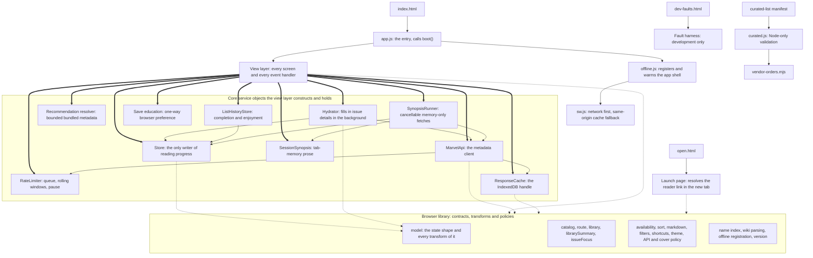
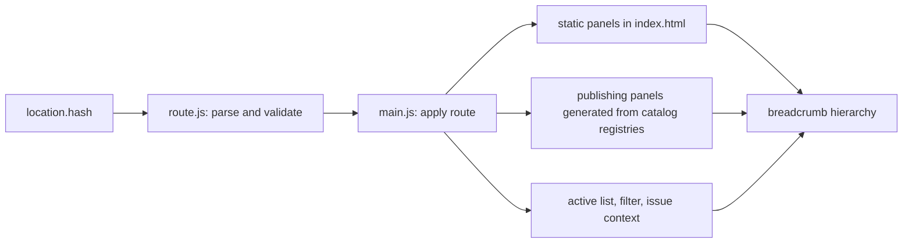
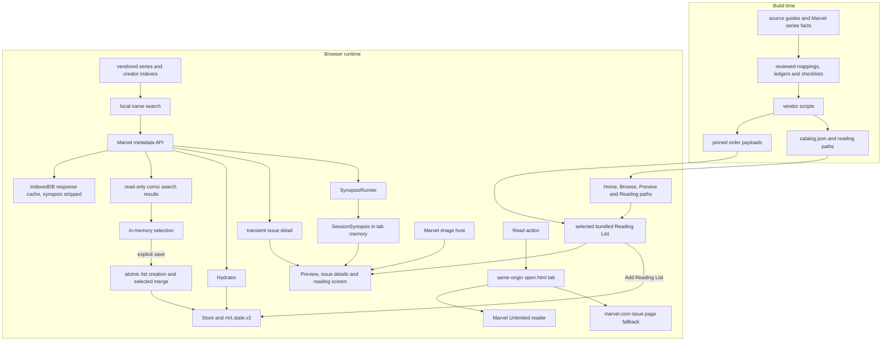
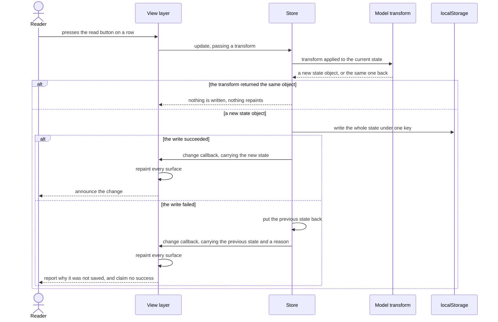
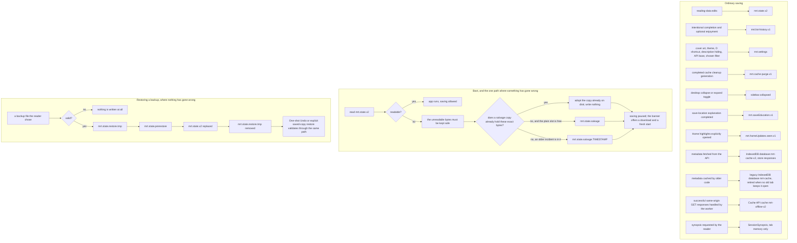
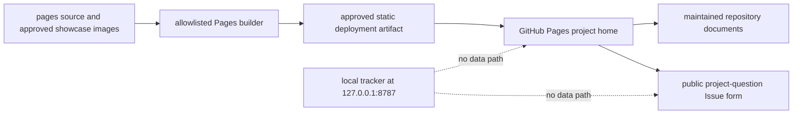

# How the app is put together

How the browser core owns state, updates screens, and saves reading progress. These diagrams describe
the current implementation, not a proposed redesign. See [Android](ANDROID.md) for the native wrapper.

GitHub renders the Mermaid diagrams directly. They need no build step or dependency, and their
source can be reviewed alongside the prose.

## The three entry points

The desktop source has three pages at one origin, each loading one module: the tracker at
`src/index.html:1415`, the reader launch tab at `src/open.html:21`, and the development-only fault
harness at `src/dev-faults.html:137`.

The tracker entry calls `boot()` and registers the offline worker at `src/js/app.js:12-24`.
Separating startup lets tests import view functions without booting the app. The external module
also satisfies `script-src 'self'`; inline startup code would require a content security policy change.

The browser loads ES modules directly from `src/`, without bundling or transpilation.

## The module graph, drawn as ownership

Most modules expose stateless functions and contracts. The controller constructs the core services
at `src/js/main.js:98-179` and keeps application-wide bookkeeping at module scope. Constructed views
own their screen-local state. That block shows service wiring, not every value held in memory.

A thick arrow means constructs and owns; a thin arrow means holds a reference; a dotted arrow means
calls without ownership.

**The view layer owns state; the library has no mutable singleton service.** Each rate limiter owns
its queue and two rolling windows at `src/js/lib/limiter.js:11-20`, so separate instances have
independent budgets. Save education and session synopsis state are instance-owned too.

**Changing the API base replaces the client and cache.** The replacement goes to the Hydrator and
SynopsisRunner at `src/js/main.js:2134-2149`. In-flight synopsis work is cancelled and its memory
cleared. The Store stays in place, as does the rate limiter: its budget belongs to the reader's
connection, not the configured service.

**The app supplies one limiter and cache.** `MarvelApi` can construct its own at `src/js/api.js:68-69`,
but that fallback is for tests and other callers. The app supplies them to keep one request budget.

**Synopsis state is intentionally separate from saved metadata.** `SessionSynopsis` is a tab-memory
map and `SynopsisRunner` is a cancellable fetch owner. Neither writes through the Store or the
response cache. The three independent refusal points are recorded at `src/js/synopsis.js:8-15`:
normalization drops prose, API cache writes strip it, and the request uses `no-store`.

**Curated authoring is Node-only.** `src/js/lib/curated.js` parses the manifest for
`scripts/vendor-orders.mjs:31` and `scripts/author-cbh-packet.mjs:6`. These never run in the browser.
The Node-only `scripts/lib/chapter-orders.mjs` turns a noncatalog source order into ordinary child
payloads, catalog entries, a reading path, and overlap evidence. The browser needs no partition
model. Other `src/js/lib/` modules are browser-facing; startup loads the cloud recovery guard and codec without connecting a provider.

## Routes and generated views

The hash after `#/` holds navigation state. The parser accepts only registered routes at
`src/js/lib/route.js:14-29`. Publishing and custom Home-category routes share definitions with their
generated screens. Static panels and buttons use separate markup; keep that markup and the registry
in sync when adding a panel.

Most panels exist in `index.html`. Publication-age leaves are the exception: `boot()` calls
`ensurePublishingViews()` before wiring navigation, so every configured publishing route gets a
panel from the same registry that made it routable. Issue addresses may also carry validated list
or bundled-order context, which lets Back and the breadcrumb return to the surface that opened the
details without guessing at browser history.

Hash routing keeps the address on the same static file and storage origin. Path routes would request
missing files; changing the origin would select different storage. See `src/js/lib/route.js:1-6`.

Completed lists is a registered Library child route. Its All completed/Enjoyed selection is
view-local, not a setting or a reader-state field. A completed list remains addressable through
its ordinary reading route, with real read and deferred counts.

## How reading content reaches the browser

Curated content and live metadata can meet in Preview, issue details, and issue-focus results, but
only the Store saves reader data. The catalog is built before release with reviewed sources and
gaps; browsing it needs no metadata service. On desktop, stopping the server leaves only previously
cached same-origin resources available, so unvisited content is not guaranteed offline. Live metadata
is optional. Synopsis prose follows a separate, memory-only path.

Targeted vendoring reuses pinned payloads for skipped orders, derives the full catalog, then writes
the complete output batch atomically, including `catalog.json` and generated overlap artifacts,
at `scripts/vendor-orders.mjs:614-668`. Runtime loads and parses that same-origin catalog once at
`src/js/main.js:1826-1837`, independently of the metadata service.

Series and creator names are searched in vendored indexes. Browsing a matching name pages its comics
from the API into a read-only preview. Issue, series, and creator results share an in-memory selection;
only an explicit save creates or fills the chosen Reading List. API responses use `no-store`, and
cache writes remove synopsis prose before IndexedDB sees them, at `src/js/api.js:81-120`. Hydration
sends normalized factual metadata through the same Store boundary as a reader edit; synopsis requests
instead end in the tab-memory map and disappear when the tab closes.

A Read press opens the same-origin launch page synchronously so popup permission is not lost,
at `src/js/reader.js:82-105`. A known digital ID redirects straight to Marvel Unlimited.
Without one, a pinned exact issue page and an already refused metadata lookup open that page
directly; the same strict HTTPS same-issue validator runs before and after opening the tab.
Other unknown references retain the configured metadata lookup and use the pinned issue page
when the lookup cannot resolve a reader ID, at `src/open.js:132-170`. The launch page never
reads or writes reading progress. Android uses the same validation in its generated launcher
while preserving the Bifrost app-link route for known digital IDs.

The launch tab reads display settings without saving them and follows explicit or system theme.
It distinguishes a pending lookup, a resolved link, missing metadata, lookup errors, an actual
timeout and unusable settings. Only pending normal-motion feedback pulses. A missing reference
offers a same-origin return instead of a generic external link. The shared app keeps conditional
no-tab guidance visible after a valid dispatch, even when `noopener` returns a null handle:
that handle does not establish that a popup was blocked. Refusals use their existing exact
message, and a subsequent valid dispatch replaces it without moving focus or marking a comic read.

## Marking one issue read

Deferral uses this same Store transaction, but belongs to the saved list rather than the shared
read map. Schema 3 stores each list's `deferredIssueIds` as a bounded, deduplicated subset in
membership order. Older schemas migrate with no choices. The existing future-schema and stale
write guards protect the same storage key when a reader returns to an older build.

`queuedIssueIds` supplies both next selection and Coming up, excluding read and deferred comics.
`listProgress` still reports actual read/total only; `listReadingProgress` adds queued and deferred
unread counts. Read status takes precedence without clearing stored intent. Membership Undo
merges only the removed member's captured choice, never another member's later intent or current
global read timestamps.

List edits, imports, reordering, and background metadata updates use the same Store transaction:

**The transform is pure; the Store writes.** The shared read action at `src/js/views/reading.js:1061-1074` passes
a function to the Store. That transform returns new state without side effects at
`src/js/lib/model.js:704-706`. The write, result, and notification are handled together at
`src/js/storage.js:709-742`.

**The repaint is synchronous.** Before `update` returns, its callback has repainted the result.
Announcements at `src/js/main.js:369-371` depend on save success, so a screen reader does not hear
"marked read" after a rollback.

**Failed writes repaint too.** The callback receives the previous state and failure reason.
The UI restores the row and shows a notice rather than making an unsaved change look saved.

**Refreshing shared state does not mean rebuilding every view.** The callback runs the shared
refresh fan-out at `src/js/main.js:2744-2770`, including the rail, reading view, Home, Library hub
and detail, Progress, API queue, Add destination, blocked state, breadcrumbs and route
synchronization. Catalog and generated publishing panels render when their routes need them. Inside
the reading view, each row is compared against a cache key built from the whole item and its node is
reused when nothing changed, while the full order is skipped entirely when its container is closed.
Focus is captured before a rebuild and restored by identity afterwards, at
`src/js/views/reading.js:744`, which is what keeps the keyboard where the reader left it. The row list is
committed by moving nodes rather than replacing the container, at
`src/js/views/reading.js:36-44`.

**Background updates use the same path.** Hydration calls `update` at `src/js/hydrate.js:59`.
Not every state replacement goes through that method, though: boot loads state at
`src/js/storage.js:413-445`, while restore and starting fresh replace it. Restore writes the key
directly at `src/js/storage.js:927-1008`, bypassing the failed-read latch because it is a chosen
overwrite, as explained at `src/js/storage.js:1075-1083`. A guard inside `update` does not cover these
replacement paths.

**Comic searches preview first and save once.** The API delivers each normalized page before it
requests the next one, at `src/js/api.js:193-230`. Each search owns a read-only run that accumulates
comics in memory, rejects invalid issue identities, and reports incomplete loads against the API's
total, at `src/js/views/add.js:94-186`. Cancellation retires the run before aborting its request;
late responses cannot replace a newer preview. Received partial results remain selectable, with
an explicit stopped or failed notice. When a focused Cancel action disappears, its search field
receives focus, at `src/js/views/add.js:594-618`.

The shared selection survives searches and issue-detail navigation, but not a document reload.
A named new list is the default destination. The explicit save composes creation, selected membership,
and activation in one Store update, at `src/js/views/add.js:30-67` and `src/js/views/add.js:69-92`.
An existing destination keeps its prior order, skips duplicate membership, and retains shared progress.
A refused write leaves the selection and intended destination intact; only a successful addition
starts hydration, at `src/js/views/add.js:326-368`. The browser warns before leaving with an unsaved
selection, at `src/js/views/add.js:1086-1090`. Manual entry keeps its existing path.

**Pasted imports have a separate durable source journal.** The storage-owned import draft keeps
verbatim source (including original full-paste line endings), recognized physical positions,
explicit match choices and duplicate occurrences. Its pure importDraft helper shares the existing
checklist parser grammar. Draft-owned membership is projected by earliest resolved source occurrence
after an unchanged destination prefix; gaps never become reader placeholders. Existing members keep
their order and editions. Only newly consumed checked occurrences affect shared read markers.

Checked source/pending intent precedes one reader transform; a verified checkpoint follows it.
The draft key uses its own lock, exact raw freshness check and readback. Reader writers retain their
existing token/expectedRaw contract, not a shared import lock or two-key transaction. Interrupted
exact-before retry additionally needs the captured reader token unchanged (absence only for a truly
empty tokenless before state); exact-after is checkpoint-only and requires explicit acknowledgement.
Changed-token return-to-before is uncertain, not permission to replay a completed checkbox.

Every draft-file restore mints a new local incarnation, retains prior serialized source snapshots
inside the same bounded envelope and starts paused. Exported identity never revives a late lookup.
Destination id/creation/order/edition/deferral checks prohibit retargeting to an edited or replacement
list. Source and backup ceilings are 8 MiB and 250,000 recognized occurrences, not a quota guarantee.
Reader schema and reading/history backups stay unchanged. Complete transfer includes the separately
labeled draft file when present. Unverifiable writes are surfaced and retain guarded source; no
rollback overwrites a newer draft. Current loaded modules use existing resource-derived offline warming.

Field corrections identify the invalid field, associate its inline report and focus it. An invalid
optional reader address opens its disclosure before focus moves. Whitespace-only names stay in the
naming dialog for correction. Explicit series and creator browsing focuses the resulting heading;
the next Tab reaches the result filter. Selecting wiki details fills the title, focuses it and
states that the entry is still unsaved. Preview keeps Open as the saved-guide action and reports
library membership separately; interior dialog padding is not a backdrop dismissal.

## Where a reader's data lives

Storage declares five key names at `src/js/storage.js:16-20`. Settings, cache-cleanup, and sidebar
preferences are owned by the controller at `src/js/main.js:83-85`; save education owns another key
at `src/js/lib/saveEducation.js:1`. The companion history store owns completion and enjoyment at
`src/js/lib/listHistory.js:7`. Home highlights viewing belongs to `src/js/lib/homeUpdatesSeen.js`.
Metadata uses IndexedDB, offline app files use the Cache API, and synopsis prose stays in memory.

Backup staging and undo are separate from failed-read salvage. They serve different recovery paths:

Every `localStorage` name the tracker writes, and why it exists:

| Key | Written by | Cleared by | Why it exists |
|---|---|---|---|
| `mrt.state.v2` | every saved change, at `src/js/storage.js:807` | erasing everything, which writes an empty state rather than removing the key | The lists, reading progress, notes, issue ratings and availability overrides. This is the reader's data. |
| `mrt.list-history.v1` | the companion history store, with read-back verified writes at `src/js/lib/listHistory.js:361-395` | verified reader erase followed by checked history cleanup | Exact saved-list identities, completion dates, and optional enjoyment. It has a separate backup and no automatic expiry or orphan pruning. |
| `mrt.import.draft.v1` | checked source, choices and checkpoints through ImportDraftStore | confirmed draft discard or verified reader erase plus unchanged captured draft/reader cleanup | Exact pasted source and positions, explicit matches, pending outcome evidence and retained previous source snapshots. Separate versioned backup; no automatic expiry. Start fresh/cache cleanup preserve it. Reading restore/Undo pause rather than replay it. |
| `mrt.state.restore.tmp` | a restore, before anything is swapped, at `src/js/storage.js:966-978` | the same restore after the swap, legacy error cleanup, a later restore or verified reader erase | Staging between validation and reader replacement. Failed removal can leave the exact staging bytes behind. Complete cloud restore includes creation and removal as separately journaled effects, so explicit recovery recognizes write-before-checkpoint crashes instead of guessing that leftover staging means success. It is not a portable data category. |
| `mrt.state.prerestore` | the same restore, after staging, verified before reader replacement | the reader's erase, and `rewindSnapshot()` at `src/js/storage.js:1104-1121`, in two of its four routes | Exact prior reader bytes, including legacy raw copies. The copy outlives reload and Start fresh. A tab identifies one Undo by the exact snapshot it created; Undo consumes that identity without deleting recovery bytes. After Undo, reload or snapshot replacement, restoration is neutrally labeled as a saved-copy replacement. Both actions confirm replacement and reject changed captured reader/snapshot values. The replaced data becomes the next raw copy, not an automatic Redo. Download preserves raw bytes even if validation refuses them. `undoRestore()` at `src/js/storage.js:1123-1140` validates promotion and refuses an identical live copy. Failed swaps rewind the earlier snapshot when possible; existing rewind withdrawal applies when no earlier copy exists or repair fails, while an unreadable earlier slot is not guessed. Erasing is the deliberate removal route. The legacy format and reader schema are unchanged; complete cloud restore uses its separate journal and does not offer a misleading composite Undo. |
| `mrt.state.salvage` | a failed read, and only when the slot is empty or already holds the same bytes | the reader, from Backup and settings | A copy of data that could not be read, kept because saving is paused and the original must not be overwritten. |
| `mrt.state.salvage.TIMESTAMP` | a failed read when the slot already holds a different incident, at `src/js/storage.js:503-509` | the reader, from Backup and settings | So a second corruption months later cannot clobber the copy taken for the first one. A `.N` is appended when that name is taken too, which one boot can reach on its own, because starting fresh salvages before it clears. |
| `mrt.settings` | the settings form, cover art, theme, D shortcut, description hiding and reading filter controls, at `src/js/main.js:525-538` | nothing | Preferences, not data, and excluded from reading-progress backups and restores. Deliberately outside the state so a settings write can never fail a progress write. D shortcut and description hiding default on; failed saves apply to this tab with a visible reload warning. Description hiding stores only a boolean: actual changes reset individual disclosure choices, not tab-held prose, and never fetch. An older `cachePurge` field is read once as migration input but is no longer authoritative or written by current code. |
| `mrt.cache-purge.v1` | successful cache cleanup, at `src/js/main.js:494-512` | nothing | A monotonic cleanup generation held apart from settings so an older tab cannot lower it by serializing the settings shape it knows. Current tabs serialize its read-max-write step through one origin-wide browser lock. |
| `sidebar.collapsed` | deliberate desktop sidebar toggles, inside the persist guard at `src/js/main.js:1026-1035` | nothing | Whether the desktop rail is compact. Narrow open and closed state is ephemeral and never writes this key. A refused save applies to this tab with a visible reload warning and no cloud commit. |
| `mrt.cloud.commits.v1` | verified cloud capture intent and exact native acknowledgement | replaced by later verified intent/acknowledgement | Hashed personal-commit witnesses and native destination binding only. Not portable content or authority to choose a stream. Exact native/current content equality can establish bookkeeping; divergent content without its known intent mapping stops cloud rather than guessing a personal change. |
| `mrt.cloud.restore.v1` | verified complete-restore preparation, before journal persistence | verified recovery cleanup under the exclusive session lease | Restore identity only, not a substitute for the dedicated IndexedDB journal. Marker/journal disagreement or inaccessible recovery pauses personal-data writers and uploads. Never clear it to bypass recovery. |
| `mrt.cloud.consent.v1` | explicit inventory/automatic-backup confirmation in a qualified native composition | verified native disconnect or cancelled connection cleanup | Consent version and selected provider, not credentials, account identity or portable settings. It cannot enable an unconfigured host or authorize upload before initial discovery/choice. |
| `mrt.saveEducation.v1` | the first nonempty saved list and first confirmed progress change, through `src/js/lib/saveEducation.js:25-74` | nothing | A one-way preference recording whether the reading screen still needs to explain where progress is saved. It is separate from reader data, reconciles across tabs, and a failed preference write never turns a successful progress write into a failure. |
| `mrt.homeUpdates.seen.v1` | explicit opening of Home highlights, through `src/js/lib/homeUpdatesSeen.js` | actual browser app-storage or owned-key deletion | The highest viewed release batch on this device, held outside reading data and backups. Key-specific locking merges the durable maximum and verifies readback. Failed viewing writes clear New for this visit with a local warning, not a reading-save error. Reading erase, Start fresh, restore and undo keep this preference. Actual absence retires queued viewing requests; only another explicit opening can recreate it. |

Fifteen rows in all: fourteen fixed names and one salvage family whose suffix is the moment it was
written. Their owners are explicit; portable backup never copies all of localStorage.

Only the reader removes salvage copies, one at a time in Backup and settings. The app cannot decide
that unreadable data is no longer wanted. A copy protecting an active saving block remains listed
but cannot be removed: downloading or starting fresh still needs it. Removal becomes available after
the block is resolved.

Reader erase is ordered, not a blanket storage clear. Its reader write must
be verified as the exact empty payload with this erase's token before history cleanup is allowed.
Cleanup checks the captured reader and history values again; a later tab's data is not erased.
Partial or unconfirmed cleanup is reported explicitly. **It does not reach the salvage copies.** Measuring that needs
a run where the erase actually lands, because a blocked store refuses the write and nothing behind
that guard runs, so a copy would survive either way and the reading would prove nothing: after
starting fresh to clear the block and then erasing, `salvageCopies()` answers 1 both before and
after, and `salvagedRaw()` still returns the bytes that could not be read. Whether that is right is
filed as `BL-113` rather than settled here, because the copies are listed on the same screen as the
erase button, each with its own remove control, and so survive in plain sight, which is a different
thing from the undo snapshot that survived behind a button claiming it had gone.

Protection compares the copy with the main storage slot at `src/js/storage.js:635-658`, not with
one tab's blocked flags. Another tab may have opened before the corruption and still consider
itself writable; it must not be allowed to remove the copy protecting the unreadable data.

**Metadata has separate storage.** IndexedDB database `mrt-cache-v2`, at `src/js/cache.js:9-12`,
keeps its quota separate from reading progress. Older code writes only to legacy `mrt-cache`.
Startup and manual clearing request that database's deletion and report partial cleanup while an
older tab blocks it. IndexedDB restrictions and the separate `file://`, `localhost`, and
`127.0.0.1` storage buckets are documented at `src/js/cache.js:3-5`. The server fixes the origin at
`server.mjs:21-23`.

**The offline shell uses a different browser store for a different job.** Cache API cache
`mrt-offline-v2` stores successful 200 responses to same-origin GET requests the worker handles,
including the warmed app shell and later requested bundled payloads. The worker rejects other
origins before opening that cache, at `src/sw.js:61-73`, so Marvel covers and metadata responses
cannot enter it. Network is always tried first, and each successful response replaces its cached
copy; a cached URL is read only when the loopback server cannot answer, at `src/sw.js:76-166`.
There is no in-app control that clears this cache. Activation removes older `mrt-offline-*`
generations but leaves the current one in place, at `src/sw.js:46-58`.

**Synopsis prose is deliberately in no browser store.** `SessionSynopsis` keeps it in a Map that
dies with the tab. The API request uses `no-store`, the response cache strips the field, and saved
state normalization refuses it. The separate boundaries mean clearing metadata, exporting a backup,
and reloading all agree that the prose was temporary.

**The launch page writes nothing.** It reads `mrt.settings` at `src/open.js:61-83` and validates
the configured API base at `src/open.js:121-130`, without touching reading progress.

**The fault harness has separate keys.** Its backup and quota-filling keys at `src/dev-faults.js:5-6`
are not written by the tracker.

### One thing the drawing found

Drawing the salvage path surfaced a defect that reading it did not. When a second incident is
salvaged, the copy goes under a dated name because the plain slot still holds the first incident's
bytes. That decision was remade from scratch on every boot, and the date is taken at the time of the
write, so reloading the page while still blocked wrote another dated copy of the same bytes. Three
boots attempted three writes, measured against the module as it then stood. Under a fake storage
only two keys survive, since all three land in one millisecond and collide on the same dated name;
three distinct copies is what the browser leaves, where the boots are milliseconds apart.

It cost nothing on a first incident. There is a test for a second, unrelated incident, at
`test/storage.test.js:394-420`, so the dated key itself was covered; what no test did was load twice
inside one incident, which is why the repeat was untested rather than tolerated. It cost a copy of
the reader's whole state per reload on a second one, in exactly the near-quota situation the
salvage code was written to survive.

It was filed as BL-076 and fixed there rather than here, because this document changes no code. A
salvage slot already holding these exact bytes is now adopted rather than written again, at
`src/js/storage.js:472-482`, so the drawing above shows a branch that did not exist when it was first
drawn. Implementing it found two things this section had understated. The repeat was not only per
reload, because `startFresh()` salvages before it clears, so the button the banner points at wrote
one more inside a single boot. And the cost was not only space: near the quota the duplicates
consumed the room the next copy needed, so a later boot reported that nothing had been set aside
while the previous boot's copy sat on disk, and the escape hatch refused on that false report.

Pressing the fix turned up a third, worse fault that reading had also missed. Because
`startFresh()` salvages inside the same boot, two archived copies could take the same timestamped
name and the second overwrote the first, destroying a copy the reader had already been promised.
The archived name is now checked to be free before it is used. The lesson is the one this section
was drawn to make: the fault was found by attacking a claim, not by re-reading the code that made
it.

## What is intentionally centralized

The controller owns routes, shared events and rendering, and long-lived services. Constructed views
own local rendering, interactions, and temporary state. Propose architecture changes in an Issue,
stating which contracts remain and which change.

The stable boundaries in this document are behavioral:

- The Store remains the only ordinary writer of reading progress.
- Completion and enjoyment belong to an independent history store, not the reader schema.
- Routes and panels derive from shared registries rather than duplicate lists.
- Vendoring finishes before release and writes one atomic generated output set.
- Cached factual metadata, the offline shell, temporary synopsis prose and reader data remain in
  separate stores with separate lifetimes.
- A Read press opens its same-origin launch tab before any asynchronous lookup.

A future file split that preserves those contracts changes the ownership diagram's boxes, not the
data flow. A change that introduces scheduling between a Store update and its repaint, moves
synopsis prose into durable storage, or makes a reader lookup precede `window.open` changes the
architecture and must rewrite the relevant section rather than merely re-aim its citations.

## Reading Paths are a catalog projection

Reading Paths add no second content or persistence model. Build-time authoring emits path
descriptions and ordered Reading List ids into `catalog.json`; the browser treats the paths in that
parsed generated catalog as the complete authority. `resolveReadingPaths()` resolves every path
independently against the same catalog stories at `src/js/lib/catalog.js:1449-1502`, including paths
emitted from a partition ledger rather than declared in the ordinary curated manifest, at
`scripts/lib/chapter-orders.mjs:392-402`.

That aggregate model is deliberately separate from shelf orientation. Shelf badges keep the first
path that reaches a story so one row has one stable position, at `src/js/lib/catalog.js:702-720`.
The aggregate resolver keeps each path's own ordinal and neighbours, so a story shared by future
paths remains a separate stop in each sequence.

Home and Browse render the same gateway descriptor from the resolved catalog and both open one
Reading paths view. The controller constructs that view with catalog loading, Store reads, route
intent and history effects rather than giving it those concrete owners, at
`src/js/main.js:3508-3561`. The selected id lives only in the validated `path` query of the hash
route, not in saved reader state, as enforced at `src/js/lib/route.js:177-262`.

The view owns the resolved paths, selected structure, selector identity and async generation. It
rejects stale or hidden continuations, falls back to the first resolved path when the requested id
is absent or invalid, and asks the controller to canonically replace that route at
`src/js/views/reading-paths.js:134-171`. A deliberate selector change instead asks the controller to
push history, at `src/js/views/reading-paths.js:174-181`.

Progress is a projection of reader state and explicit completion onto each stop. Completion can
advance a stop without pretending unread or deferred comics were read. The Reading Paths module prefers the imported
list whose catalog id exactly matches the stop, then the first imported sibling in catalog order,
then reports **Not added**, at `src/js/views/reading-paths.js:11-29`. Cross-tab state replacement and
whole-origin clearing call the constructed view's progress repaint at
`src/js/main.js:211-235`; that repaint updates progress and the stop action in place at
`src/js/views/reading-paths.js:55-70`, preserving the selector and action DOM identities.

Stop actions preview the path's explicitly authored list, including its source disclosure and gap
metadata. Owned stops open the actual saved list represented by their progress, with alternate
versions named explicitly. Inspection does not import or mark read.
The current history entry remembers only the path and stop identity. After Back renders that path,
native focus brings the original action into view; there is no persisted scroll position.

Catalog shelves, Preview and generated publishing pages share one constructed presentation
contract for individually titled cards, exact-list inspection, source disclosure and path links.
That internal module imports neither the controller nor another concrete view; the controller injects
navigation, imports, Store effects and publishing-page orchestration at
`src/js/main.js:3370-3506`.

Closing an unchanged Preview leaves its source cards and focus intact. A changed library refreshes
the source, including an Add that finishes after dismissal. Each refresh belongs to its specific
library revision and Preview session; navigation or a newer Preview cancels stale loading,
rendering and focus work.

## Modern Timeline position is a Store projection

Modern Timeline stores no cursor. Its catalog view builds one first-match index from the saved
Reading Lists' catalog identities, walks the canonical unfiltered story order and stops at the first
representative list that is absent or neither explicitly completed nor wholly read, at `src/js/views/catalog.js:28-70`. Grouped
stories retain their shallowest-owned representative for logical stop completion, but each
alternative has its own card and the marker belongs to that specific list. A catalog with a
dropped entry reports the position as unavailable because the parser no longer has enough identity
or order information to place that gap.

Filtering changes only the visible list keys. The view retains canonical stories and visible keys
from the current successful render, derives position from live Store state, and rejects marker
refresh while a newer catalog render is pending, at `src/js/views/catalog.js:139-181`. A hidden
current story is named rather than replaced, full completion sits after the unfiltered spine, and
filtered completion is stated before the narrowed results.

The shared presentation contract removes the previous positional state and paints exactly one
current label, hidden message, completion state or unavailable message at
`src/js/views/shared/catalog-presentation.js:243-293`. Only the visible current list receives
`aria-current="step"`. The controller injects live state and current-view knowledge at
`src/js/main.js:3411-3444`, while the existing Store-driven render path calls the position-only
refresh at `src/js/main.js:2744-2770`. That refresh leaves cards, controls, focus and scroll
intact across same-tab and cross-tab state changes.

## Completion is independent history, not a reader migration

Issue ratings are a sparse map in the primary reader state, with one numeric value from 0.5 to
5 per issue ID. They do not require a read marker, list membership or saved issue metadata.
Clearing removes the entry; read/unread changes and list removal retain it. The Issue editor
discloses its full controls only on request, keeps unsuccessful drafts, and withdraws Save when
the saved score or saved comic identity changes.

Schema 4 adds ratings to the existing primary persistence, backup, restore/Undo and erase
contract. Schemas 1 through 3 migrate with no ratings; schema-3 deferrals remain intact.
Malformed schema-4 ratings are refused rather than silently dropped. Older builds cannot read
schema 4 and preserve it through their existing unsupported-schema recovery path. No second
ratings store or ratings-specific backup file is introduced. The optional composite cloud backup
is a separate feature and does not change this persistence contract.

The Library's Top-rated shelf and the `#/library-rated` browser are derived views over that same
map, so they add no key, schema change or migration. Filters are route state only. Character guide
filtering reads `src/data/rated-guide-index.json`, which the vendor writes in the same atomic batch
as the catalog. It records which guides contain each issue and those guides' editorial character
labels, so a match is a guide association rather than a verified appearance. The index loads on
entry to the browser; while it is pending or has failed, the character filter is reported as not
applied rather than silently ignored.

The reader uses schema 4 under its existing key. Issue ratings join its primary backup; list
completion and enjoyment stay in the companion history. Ordinary completion, list enjoyment and
reopening do not rewrite valid current reader bytes, including the write token. Supported older
reader data remains accepted by history normalization.

History matches the existing list ID, creation value, and catalog identity exactly. Removed-list
records remain for matching Undo or reader restore; duplicates and recreated identities do not
inherit them. Reopening clears completion while retaining an optional rating. Counts stay actual
comic progress, and the active shelves derive their selection without changing the reader's saved
active list merely because completion changed.

History mutations capture their current stored value before waiting for a native browser lock,
then compare full values and verify the write by reading it back. Stale operations adopt current
data and refuse the old action. Unsupported locking is visibly read-only, and unreadable or newer
history is retained rather than treated as an empty collection. Legacy lists with ephemeral IDs
use only the existing canonical reader normalization, guarded by exact reader bytes and durable
identity verification before history can be attached.
Changed and idempotent list actions return that verified identity as transient result metadata.
The controller matches it against the current view and list before announcing success or moving
focus. Same-ID normalization is accepted; subsequent identity replacement is not.

Reading backups, restores, and restore Undo remain independent. History export and confirmed
replacement have their own controls. A differently labelled saved-value copy preserves unreadable
history for troubleshooting, but is not accepted as a normal backup. Reader erase and history
cleanup verify exact current witnesses, with partial cleanup reported rather than hidden.
Verified reader erasure synchronously withdraws the old removal buffer and temporary reader
links before waiting for history or cache cleanup. Its exact empty-reader bytes are a transient
witness, not a saved field. After the waits, the callback adopts current history, queries the
current restore snapshot, and compares/adopts reader data against that witness without withdrawing
newer offers. Snapshot reads can opt into error reporting while ordinary rendering retains its
no-argument behavior. Explicit cache false or throw and unknown final reads are warnings, not
empty-state success; the cache owner's existing default unavailable-access policy is unchanged.

The wrap-up resolver uses the catalog's actual Reading Path and Modern Timeline sequences,
verified writer-role credits, and exact series identities with strictly later publication spans.
Keywords only shortlist candidates; missing evidence never becomes a displayed relationship.
It excludes source siblings, completed or wholly read stories, and known wholly globally read
candidate rosters even without saved membership. Work is bounded to six cards, six candidate
files plus at most one source file, and a cache of at most 12 files or 4,096 issue records.

Saved suggestions open their existing copy; other suggestions open Preview without importing.
Request identity, cancellation, reader-state identity, list identity, and completion revision
reject stale results after navigation or reopening. Feedback links are static, with no private
values in their query. A thumbs choice never submits a report; public list corrections and private
data-loss/security reporting are separate opt-in routes.

## Where to read next

[Why this is a browser app and not an Android emulator](WHY_A_BROWSER_APP.md) records why the app
sits beside Marvel Unlimited rather than replacing it. [Data provenance](DATA_PROVENANCE.md)
continues the build-time side of the content flow, and [Maintaining Recap Page](MAINTAINING.md)
owns the procedures that generate and release it.

The [UX study](UX_STUDY.md) and the documents under `docs/ux` are dated design evidence. They explain
decisions made during earlier interface passes, but the current README, running guide and tested
route registries own the behavior a reader should expect now.

## The Windows package is a launch envelope

The x64 and ARM64 MSIX packages add a small JavaScript coordinator around the existing browser
companion. They do not add another application runtime or persistence model. Start launches the
architecture-matched packaged Node executable with `Launcher.mjs`. The coordinator removes every
casing of the two environment values that can change the origin or suppress browser opening, starts
the same Node executable with `server.mjs` as a hidden detached process, and waits for a cache-proof
health response naming the digest of the exact package inputs. It also verifies that the listener is
the current package's Node executable running the current packaged server command. Only then does it
open the external browser. Another activation applies the same checks before reuse. A foreign or
older listener, launch failure, or readiness timeout remains visible with corrective guidance.

Direct manifest activation of Node was measured first. It started the right command and served the
right origin, but its console closed immediately when Node refused an occupied port. Package Support
Framework kept the command wrapper visible, but Microsoft's distributed binaries may send
usage telemetry when Windows diagnostic collection is enabled. An x64 C# launcher proved the
installed behavior, but the Windows inbox compiler cannot emit ARM64. The selected coordinator uses
the official Node runtime already in each package, so both entry processes are native to their slice
without a second runtime or a higher Windows version floor.

The background server normally lasts until the Windows session ends, the package is updated or
removed, or the reader explicitly ends it in Task Manager. Closing the browser does not stop it.
This is intentional: the first Store certification run proved that tying the server to a visible
console can leave the service worker showing a cached shell after the server has died. The shell
cannot safely imply that uncached local data remains available, so its cache-proof health probe also
drives recovery guidance for catalog, Reading List, creator-index, and series-index failures.

Package files remain read-only. Browser state remains under `mrt.state.v2` and the other stores
described above, in the external browser's exact origin and profile. The package never reads or
writes those stores. [The Microsoft Store package guide](MICROSOFT_STORE.md) owns build, proof,
identity, cleanup, and remaining publication gates.

## The public project home is not an app entry point

GitHub Pages serves a separate information site. A deterministic builder copies approved HTML, CSS,
and showcase images into ignored staging. Deployment uploads only that allowlist, never `src` files,
a manifest, a worker, or a launch page.

The page has no script or form. Ordinary links lead to maintained documentation, releases, and issues,
where the detailed guidance stays.

The question form is also hosted by GitHub. Before linking, the page explains that posting requires
sign-in and makes the Issue and replies public. The tracker calls neither surface. The form receives
only what a visitor types, and neither surface can read storage at `http://127.0.0.1:8787`.

[Maintaining Recap Page](MAINTAINING.md) owns the exact form contract, deployment settings, hosted
verification and rollback order. Removing source files alone does not unpublish an existing Page,
and removing the form cannot recall an Issue or reply that GitHub has already published.

## Optional cloud credential boundary, implementation in progress

`host/cloudCredentials.mjs` is a Node-only credential-persistence factory outside the static
application. It selects CurrentUser DPAPI protection, verifies a unique synthetic encrypt/decrypt
probe before opening an account cache, and fails explicitly without a plaintext fallback.
Unsupported hosts reject before loading native code.

The same module loads a stable 32-byte host cookie-signing key in a separate protected identity
namespace. Exclusive directory reservation prevents concurrent initializers from generating
different accepted keys. The encrypted record is verified and flushed before an exclusive,
flushed completion marker is published. Existing identities require both that marker and a valid
protected record before use; corrupt, missing or interrupted identity files cause an explicit
cloud-only failure, never automatic key rotation or plaintext replacement. Preserve those files
before manual recovery. Reopening does not rewrite the key, and disconnecting provider accounts
must not remove this host identity.

The factory is used by the native authentication component below, not by provider storage or app
controls. It does not establish a working cloud backup or successful real-account, scope, restart
or cross-platform proof.

`host/cloudOAuth.mjs` holds short-lived desktop authorization transactions only in the Node host.
It issues random state and S256 PKCE challenges, binds each attempt to its profile, provider,
connection epoch and exact temporary loopback callback, and consumes valid attempts before token
exchange. Replacement, cancellation and expiry invalidate pending attempts. Pending state is bounded;
neither provider errors nor request failure diagnostics echo callback URLs or credentials.
`host/cloudCallback.mjs` owns a temporary IPv4 loopback listener, separate from the app origin.
It advertises localhost for Microsoft and numeric loopback for Google, accepts only exact-host
GET navigations to its root callback, and closes after completion, denial, cancellation or expiry.
Unexpected internal faults terminate sign-in explicitly; callback pages never reflect credentials.
Cleanup is scoped to its own state so an older listener cannot cancel a newer profile attempt.

`host/windowsCloudAuth.mjs` combines that listener with the native Microsoft and Google SDKs.
Each provider has a separate CurrentUser-protected cache within the host-issued profile.
Identity and required app-storage permission are checked before saving credentials; Google identity
also requires a verified ID token and matching nonce. Native token refresh and cache writes are
serialized, and connection-epoch checks run after asynchronous operations. Disconnect invalidates
work immediately, waits for active operations, and verifies cache removal. A corrupt cache exposes
an explicit reconnect-required state while keeping Disconnect available.

`host/windowsCloudProfiles.mjs` supplies process-local native adapter ownership for later host
integration. Concurrent calls share initialization; separate profiles have separate owners.
Connection epochs fence late initialization and operation results, and switching providers requires
successful explicit disconnect. Failed credential cleanup retains the stopped owner for retry,
blocking reconnection instead of discarding that failure. Initialization failures remain explicit
and require host configuration/recovery rather than silently selecting a different provider.
This owner is not durable destination or stream association, discovery or production activation.

SDK requests use bounded, non-redirecting host transport restricted to authentication endpoints.
Google desktop authentication requires the registered client ID and client credential as native
configuration before opening sign-in. That credential is never placed in source, browser assets,
snapshots or diagnostics. Desktop applications remain public clients: the client credential is
not a substitute for PKCE, state or verified account identity.
Provider refusals retain HTTP status and an allowlisted OAuth error code only, never arbitrary
provider descriptions, response bodies, authorization codes or tokens. Error replies have the same
size bound as successful replies.
Sign-in returns account status only; access-token retrieval is a host-only method, not a browser API.
The server accepts an explicitly supplied cloud control handler before static dispatch; ordinary
startup keeps its existing static-only behavior until native configuration and packaging are ready.
`host/cloudControl.mjs` provides the control boundary for that integration. POST-only session,
status, connect, disconnect, discover, choose, read, write, reconcile and maintain requests require the exact app Host and Origin, bounded UTF-8 JSON
and fixed field schemas. Signed host-only HttpOnly SameSite cookies bind native profile identity;
short-lived CSRF capabilities are bound to that profile. The integration must supply a stable
protected host signing key and reuse epoch-aware native adapters, never browser-provided paths,
tokens or target URLs. Controls are bounded to 4 KiB except complete snapshot writes, capped at
32 MiB. Responses project only validated operation-specific fields; credentials and native extras
are discarded. Snapshot reads revalidate the portable container. Acknowledgements distinguish
portable `contentDigest` from full envelope `byteDigest`, with exact attempt, generation and
connection epoch. Native errors are redacted and unavailable configuration fails explicitly.
The native service below supplies the storage operations, but ordinary server startup and browser
controls still do not activate it.

`host/windowsCloudHost.mjs` supplies the configured native composition through that existing
server injection. A trusted host caller supplies an absolute private directory, the two native
client registrations and browser-launch function. Configuration is copied and frozen before
asynchronous work; arbitrary endpoint fields and a Microsoft public-client secret are rejected.
The protected persistent signing key loads once, only after request admission. An unsupported
platform or failed native protection refuses cloud controls without loading account credentials,
regenerating a key, retrying failed initialization or blocking static reading. This factory composes
the actual durable native backup service, not an alternate browser proxy. Normal startup and
production dependency adoption remain gated.

Actual SDK exchange, refresh and encrypted-cache reopening have been exercised with synthetic
provider replies on Windows ARM64. Both providers also passed real Windows account and required
permission verification, plus protected-cache reopening and silent token acquisition in a separate
process on ARM64/Node 24. Separate authorized synthetic file uploads and exact read-backs passed
for both providers under the existing app-storage permissions. No personal reading data was
uploaded. Cross-platform permissions, storage identity,
other supported runtimes/architectures and terminal upload outcomes remain unverified.
Authentication packages are still qualification candidates, not production dependencies.

`host/cloudProviderTransport.mjs` is the host-only storage HTTP prerequisite, not an enabled
backup adapter. It bounds request and streamed response bytes to 32 MiB and each complete HTTP
exchange to 30 seconds. Fixed Google/Graph API destinations receive native bearer credentials;
Microsoft upload-session and download capability URLs never receive that bearer. Only validated
provider destinations are accepted. Microsoft upload sessions accept legacy `up.1drv.com`
subdomains and the exact `my.microsoftpersonalcontent.com` host observed in an authenticated
Graph session response. Downloads accept legacy `1drv.com` subdomains and that same exact
personal-content host, also observed in Graph's authenticated content-download response.
Arbitrary personal-content subdomains remain rejected. These are destination guards, not
capability provenance: adapters must obtain capabilities from authenticated Graph, bind sessions
to the exact durable attempt in protected native storage and associate downloads with the selected
file. A missing metadata download annotation requires the documented content route.
An authenticated Microsoft GET `/v1.0/me/drive/items/{id}/content` may return a 302 with a
validated download destination and empty bytes; the adapter issues a separate no-bearer download.
That capability may return one further explicit handoff only to a distinct HTTPS URL on its
identical approved origin. Selected readers permit one extra GET, not a redirect loop. Changed
origins, self redirects, further handoffs and session or mutating redirects remain failures.
Neither transport enables automatic redirect following, acquires capability bearer credentials
or accepts a redirect as downloaded content.
The native debug diagnostic records only a fixed invalid, origin or self-refusal category,
never the refused destination.
Redirects are not followed, and resumable progress remains
distinct from completion. Provider refusals retain status and a parsed retry delay, not response
bodies or token-bearing URLs. A dispatched mutation's transport failure stays outcome-unknown,
including HTTP refusals: only the later provider protocol may prove it terminal or fenced.
Callers must persist intent before dispatch and must not treat these bytes/status results alone
as an acknowledged snapshot. No automatic retry, durable stream ledger, live storage proof or
browser API is supplied by this component.

`host/cloudProviderReads.mjs` supplies native root-file candidate enumeration and selected-file
reads through that transport. Google explicitly requests `appDataFolder`; Microsoft resolves
`special/approot` and checks each file's parent item and drive rather than using a localized folder
name. The first app-root lookup can create Microsoft's app folder, so callers must invoke it only
after the explicit connection consent, never during ordinary startup. Once ownership is known,
both Node and Android readers use the exact stored item ID and drive with the app-root marker.
Missing owned storage fails without falling back to a folder-creating special lookup.

Discovery accepts at most 20 pages, 2,000 entries, 1 MiB per metadata reply and 8 MiB of listing
metadata. Repeated pages, duplicate IDs, incomplete searches, malformed entries and foreign
continuations fail explicitly instead of returning partial results. Microsoft continuation URLs
must stay on the exact enumerated item route and use only paging/select/top parameters. An
unsupported provider continuation shape fails closed and needs qualification, not a broader proxy.
Directories and files without explicit `application/json` metadata are excluded; nested directories
are not traversed. File names and timestamps are
display metadata, not proof that a file is a backup or that its generation is current.

Selected reads recheck app-storage membership, JSON type and identity before downloading, bound content by the declared size
up to 32 MiB, and require an exact byte count. Graph content handoffs use a separate no-bearer
download. The result contains projected file metadata, native bytes and their SHA-256 digest, not
capability URLs. Host-owned connection-epoch checks before and after each request reject late
results after disconnect or account replacement. These routines do not validate the future snapshot
schema, classify installation streams, persist destination ownership, acknowledge an upload or
clear an unknown-write fence. They are not wired to app controls or production startup.

`host/cloudGoogleTerminal.mjs` provides the Google-specific native ledger terminal verifier.
It reloads the exact attempt-bound protected session and sends only an empty resumable status
PUT. Google's documented 200/201 completion must identify the expected fixed slot and byte
length; the selected app-storage file must then match the pending attempt's exact SHA-256 bytes.
Only that combination yields the ledger's completed/no-outstanding-mutation proof. Incomplete
308, missing/expired sessions, stale connections, malformed replies and mismatched bytes retain
the fence. Status verification never resends content or retries automatically. The routine is
tested through the ledger callback and protected-session/transport boundaries, but is not wired
to startup or browser controls. An explicitly authorized Windows ARM64/Node 24 test deliberately
discarded the final synthetic content reply, retained unknown intent, then reopened in another
process and verified real completed status plus exact bytes before acknowledgement. This is not
proof of arbitrary still-in-progress late completion, Android or full app-stream integration.
It supplies no Microsoft terminal proof.

`host/cloudGoogleWrite.mjs` is a host-only fixed-slot write prerequisite, not an enabled backup
worker. It checks both reserved IDs against the app-data listing and validates the exact bytes
of every previously committed slot before choosing a new generation. A foreign or missing slot
blocks dispatch rather than replacing another file. A new slot uses its previously reserved ID
and the `appDataFolder` parent in a resumable create; an older committed slot uses resumable
PATCH. Both paths durably dispatch one ledger attempt before initiation, save the returned
session under the exact attempt in native protected storage before sending content, and never
retry an ambiguous operation. A failed or lost initiation or content response retains an
in-flight/unknown fence across restart; a successful content response alone cannot acknowledge
the slot. Its native `writeSnapshot` path copies portable components before asynchronous work,
encodes the shared envelope with host-generated attempt/capture identity and the selected
generation/slot, then reserves that exact byte hash against the expected ledger sequence.
The ledger retains its original preparation API; an explicit reservation must supply both its
host-generated identity and unchanged sequence. A competing transition refuses the candidate
before dispatch instead of creating an envelope for another attempt. Only the protected Google
terminal verifier with exact selected-byte readback may settle it. Deterministic tests exercise
create, rotation, complete envelope/ledger identity, lost response/reopen and foreign-slot refusal.
They do not establish startup activation, Android implementation or Microsoft terminal proof.

`src/js/lib/cloudSnapshot.js` defines the version-one composite cloud format and coherent
persisted capture. It includes canonical reading data, independent completion history, the
allowlisted preferences and explicit sidebar true/false/unset value, plus a saved import draft
or explicit null. Draft source text, source positions, duplicate occurrences, selected comics,
destination and retained previous source strings are portable; active revision/incarnation,
reader write identity and pending-publication context are not. An unsettled publication or an
unavailable recovery guard blocks capture rather than uploading an intermediate result.

The codec reuses existing component validators, rejects unsupported or lossy reading state,
checks each existing 8 MiB component bound and a 32 MiB UTF-8 envelope bound, and requires
per-component and whole-content SHA-256 matches on download. Canonical key ordering keeps
content digests independent of storage tokens, export timestamps and remote capture identity;
array order and all selected data remain meaningful. Capture reads only the selected persisted
keys, compares their exact raw values before and after asynchronous hashing, and tries at most
three times when another writer races. It never reads salvage values or credentials and never
writes storage or calls a provider.

Pure preparation APIs in the existing reader/draft and history owners serialize their exact
intended restore bytes, including freshly generated identities, before any replacement. The
codec's `prepareCloudRestore` requires the exclusive-session guard, validates the whole download,
captures exact prior values, prepares the reader temporary/pre-restore effects and separate
settings/sidebar effects, and rechecks its prior-value witness. It preflights the expanded paused
draft with displaced/retained source before returning a write-set. Explicit absent-draft and
unset-sidebar removals remain guarded effects; unsaved retained source is preserved in the
prepared record even when the chosen draft is null. Preparation does not apply a write-set,
persist a journal, supply the session interlock, schedule uploads or wire startup/controls.

`src/js/lib/cloudRestore.js` applies one validated fixed-owner effect at a time only when its
caller confirms an exclusive lease and the exact verified durable journal. It consumes the
prepared strings/removals unchanged, checks the complete known before/after image, and
recognizes bytes already written before a missing checkpoint rather than writing them again.
Unsupported keys/effects and foreign local values are refused. A failed or unreadable write
does not trigger an automatic rollback. Explicit prior recovery can reverse known effects under
the same guards. This narrow apply owner does not acquire locks or regenerate prepared values;
the session controller below supplies its verified journal and exclusive lease.

The owner approved qualifying AppAuth 0.11.1 as the Android Microsoft-auth alternative to the
license-blocked MSAL transitive closure, while retaining Google AuthorizationClient. The candidate
closure has exact/inherited POM license evidence, integrity locks, no matched advisories
for its resolved coordinates, and native compilation/lint against Android 36. Dependencies and
qualification activities are debug-only; release startup and runtime dependencies are unchanged.
Physical Pixel/API 37 qualification passed protected-cache isolation, corruption/key-loss refusal,
and separate-process reopening. Google native sign-in and silent reopening verified its exact
registered client, required scope and Windows-bound account identity; the test association was
cleared. Microsoft native sign-in now verifies the same Windows account and required scope on the
physical device; silent refresh reopened its protected association in a distinct process before
scoped cleanup. Public-client token forms explicitly include the SDK's no-auth client identity
assertion, separately from its token-request parameters. The debug harness waits for a resumed
screen and invalidates its bounded nonce lease on cancellation; inactive return links cannot
restart an exchange or save late credentials. Matching identity is not shared app-folder storage,
cross-platform restore or production package acceptance.

`host/cloudDestination.mjs` supplies the immutable native installation ownership prerequisite.
Its namespace separates profile, provider and hashed stable account identity. The record also
binds the exact native client, provider app-root identity and drive, a random host-generated
installation stream, and exactly two distinct provider-reserved slot IDs. Google uses the
`appDataFolder` root identity; Microsoft requires the discovered item and drive IDs.

Explicit initialization exclusively reserves the destination directory, writes and flushes a
bounded strict manifest, verifies its exact bytes, then publishes a flushed completion marker.
Reopening requires both files and the exact current native binding; it flushes observed complete
files before returning the unchanged mapping. Concurrent initialization cannot replace an owner.
Incomplete, mismatched, corrupt or unexpected records block uploads rather than trigger automatic
stream regeneration. Reopening cannot replace the slot mapping or import ownership from a
restored snapshot. The returned metadata contains account/client hashes, not provider credentials.

This local prerequisite does not discover or allocate remote slots, authorize uploads, store a
connection epoch, initialize the stream ledger or remove credentials. Integration must obtain
discovery and explicit separate-device choice before initialization, persist reserved IDs before
remote creation, and fence disconnect/account-switch operations separately. Credential removal
must not erase the ownership record or its unresolved stream journal. Missing local ownership
never grants authority to overwrite an existing remote stream. No production route uses this
component yet.

`host/cloudStreamLedger.mjs` supplies the native stream intent journal prerequisite. Its namespace
binds one host profile, provider, hashed stable account identity and random stream to two fixed
remote slot IDs. Every transition exclusively appends a bounded record, flushes it and checks
its exact bytes. Reopening validates the complete contiguous hash-linked transition history,
never skips a damaged tail, and flushes an observed complete tail before using it. Competing
owners cannot both reserve the same next transition. Partial initialization or append stays
visible and blocks further work; it is not silently removed or regenerated.

Preparing reserves a strictly increasing safe-integer generation, attempt ID, envelope-byte digest,
connection epoch and inactive slot. Writers also persist the exact upload length so Google status
reconciliation survives restart without a caller remembering it. Dispatch is claimed durably once. Both in-flight and unknown
states fence later preparations across reopening, including a new process. Only a host-injected
provider verifier may settle the exact attempt: completion requires terminal/no-outstanding-write
evidence plus exact remote read-back; proven failure consumes its generation without changing the
last acknowledged slots. An upload session may attach one opaque reference to separately protected
native persistence, never a capability URL in this journal. A read-only historical terminal lookup
validates the retained history before returning an exact attempt/binding/slot witness for native
session retirement.
Later unknown work remains fenced while an older completed attempt is looked up or retired.
Read absence, timeouts and connection replacement cannot clear a fence.

Each active journal segment permits 8,192 records of at most 8 KiB each. Preparation reserves
capacity for the remaining upload transitions rather than stranding a dispatched attempt at the
limit. Explicit maintenance refuses every unresolved attempt. It first retires completed session
capabilities, claims the next sequence exclusively, and publishes a flushed checkpoint containing
the unchanged generations, slots and terminal attempt before pruning superseded history.
Competing reservations defeat the maintenance claim instead of being discarded. A complete
interrupted claim can resume; partial/corrupt records remain an explicit recovery error. The
checkpoint makes earlier retired capabilities unnecessary to later terminal lookup. It is not a
way to clear unknown outcomes. An undispatched prepared attempt can separately be abandoned,
consuming its generation; a stale process then cannot dispatch it.

`host/cloudUploadSessions.mjs` supplies immutable Windows resumable-session capability persistence.
It reuses CurrentUser protection and the transport's provider session-destination validator.
Random opaque references identify records bound to the exact profile, provider, account, stream,
attempt, connection epoch and fixed slot. Exclusive reservation, encrypted read-back, flush and
a flushed completion marker precede returning a reference. Reopening requires the completed file
before loading the native SDK, rejects mismatched bindings, and never replaces a corrupt or
missing record. Capability URLs remain native-only, outside the unencrypted intent journal.
Failures retain files and leave the stream fenced. Native retirement requires an exact validated
historical terminal witness, not a caller success flag. It flushes an irreversible binding/reference
marker before deleting only the owned ciphertext and verifies absence. Any retirement marker,
including an incomplete one, withdraws loading before the native SDK can open credentials. Failed
cleanup remains explicit; a valid marker can resume cleanup without recreating missing ciphertext
or altering auth caches. Per-reference exclusive native leases prevent an already-started SDK
opener from recreating ciphertext after retirement; interrupted leases fail closed. The marker
contains no capability URL. Bounded maintenance prunes only terminal, capability-free tombstones,
first moving them out of the loadable namespace and then removing only their known empty files
and directories. Active/unknown capabilities and unexpected files are retained. No recursive
deletion, credential SDK opening or expiry-as-terminal assumption is used. Actual Windows ARM64/Node 24 synthetic encryption
and separate-process reopening were verified without accounts or network access; this does not
prove live uploads.

`host/cloudMicrosoftTerminal.mjs` is a legacy conditional-protocol candidate, not the registered
replacement Microsoft writer or a qualified backup adapter. Its nonempty conditional requests use
exact Microsoft item-ID content PUT and metadata PATCH routes. Conditional content PUT requires
that precondition; Google requests and Microsoft capability sessions cannot use it.
`readConditionalFile` additionally requires a strong item eTag before downloading JSON content,
without changing the existing `readFile` result shape. The Microsoft ledger may persist that exact
condition as immutable attempt intent. Older attempts without it, and resumable-session attempts,
cannot adopt the candidate verifier.

The verifier accepts only the exact native account/profile/stream/slot and active attempt. An
unchanged tag requires one conditional description PATCH, followed by a fresh conditional read.
A lost or refused fence reply is not proof: only a freshly changed strong tag can pass the fence
prerequisite. The independently computed byte hash then distinguishes the pending content from
a proven failed write; a failed generation is consumed without replacing acknowledged slots.
An unchanged/unverifiable tag, missing file, malformed reply or changed connection retains unknown
state. No content is resent, and no timeout, expiry, local abort, absence or old bytes alone clear
the fence.

Deterministic tests cover persisted conditioned intent in another process, exact-byte completion,
metadata fencing with retained old bytes, and unknown/stale/legacy protocol refusal. A separate
authorized live experiment observed delayed and stale conditional writes rejected with 412 and a
description update changing the eTag without changing content. That empirical observation is not
a normative guarantee that a still-pending content request is checked atomically at its final commit.
The direct-content API reference does not document `If-Match`. A separately authorized Windows
ARM64/Node 24 run now discarded a completed conditional write's final reply, retained native
unknown intent, then reopened the account and ledger in a distinct process and verified exact
bytes before acknowledgement. This qualifies that observed completed-write/restart path, not an
arbitrary still-pending late commit or production two-slot allocation. Production integration
remains blocked on the remaining protocol, lifecycle and platform gates. No normal app route
activates this candidate or treats the unit fixture as provider proof.

`host/cloudMicrosoftWrite.mjs` is the corresponding unwired fixed-slot writer. It requires the
exact native account/profile/stream ledger and two already allocated IDs, verifies the stored
app-root item and drive directly without creating a special folder, and checks both slots before
preparing intent. An acknowledged slot must retain its exact byte hash; an uncommitted slot must
contain the exact `MICROSOFT_CLOUD_SLOT_SEED` reservation marker. An arbitrary existing JSON file,
including a qualification fixture, cannot become an owned empty slot. Allocation and the explicit
initial device choice are not supplied by this writer.

The writer copies bytes/components before asynchronous work, encodes complete snapshots with
their actual host-generated attempt/generation/slot identity, and reserves the selected strong
eTag and exact byte hash against the unchanged ledger sequence. It dispatches one conditioned
item-ID content PUT; only native terminal verification can acknowledge it. Unknown intent blocks
every later provider call across reopening, including a queued newer snapshot. Exact-root,
seed/committed-byte and stale-reservation failures refuse dispatch. Deterministic cases cover
rotation, retained previous bytes, copied complete-envelope identity and late A/reopened B fencing.
They do not create remote files, activate startup, establish Android support or finish the
provider guarantee and platform gates.

The replacement OneDrive protocol separates immutable snapshot data from conditional publication.
Two fixed per-stream record files keep an immutable seed body and a small canonical publication
in their description metadata. Each publication binds stream, logical slot, attempt, generation,
payload ID, byte length and byte digest. The portable snapshot remains version 1; its slot ID is
the fixed publication record, not the payload file. The bounded canonical encoder is shared in
shape with the native implementation at `host/cloudMicrosoftPublicationRecord.mjs:44`.

OneDrive Personal can return entity-encoded punctuation in description metadata. Remote reads
decode named quotes and decimal ASCII references once, then enforce the unchanged canonical
record schema. HTML markup, nested encodings and noncanonical records are rejected. Local
journals still require canonical wire text. Fencing compares the validated canonical record with
durable intent while retaining exact before/after raw-description and strong-tag guards.

The writer freezes the record's strong tag before dispatching a uniquely named payload upload.
It verifies the complete immutable bytes and retires the completed payload capability before
publishing through a same-record conditional metadata PATCH. It never overwrites a published
payload or relies on undocumented conditional content PUT behavior. The Windows writer starts at
`host/cloudMicrosoftPublication.mjs:257`; the native counterpart starts at
`packaging/android/app/src/main/java/io/github/raymondnassar/recappage/prototype/CloudPublication.java:252`.

An unknown publication is settled only after an acknowledged conditional fence preserves the
validated current pointer and changes the record's tag. A delayed older publisher retains its
original condition and cannot replace the newer record. Payload-upload uncertainty is separate:
it remains retained for capacity and cleanup even when publication is fenced as failed. The
Windows reconciliation owner is `host/cloudMicrosoftPublication.mjs:228`, and its versioned durable
state is opened at `host/cloudPublicationLedger.mjs:68`. New destination and journal namespaces
cannot reinterpret a legacy unknown attempt.

Each stream retains two publication records, up to two referenced committed payloads and at most
two staging or unreferenced payloads including active work. Reservations precede remote creation;
the writer pauses at that bound. Only terminal, retired, unreferenced and identity-checked payloads
can be removed. A cleanup intent is durable before a conditional exact-ID DELETE, with enough
journal capacity reserved to record its outcome. Root errors cannot masquerade as that payload's
absence. Unknown payload uploads are never retired or deleted from a 404, expiry or old bytes.
The cleanup owner is `host/cloudMicrosoftPublication.mjs:151`.

These are source and controlled-boundary implementations, not new live provider or native-device
acceptance. The direct-source-URL completion forms and a full-size data-URI candidate did not
qualify the old two-file approach. Their recovery records remain preserved. Production startup,
real protocol, cross-platform restore, package and required human checks remain gated.
Older native adapters cannot interpret publication records. The immutable payload remains a
version 1 portable snapshot; existing manual reading, history and draft exports are unchanged.

`host/cloudAllocation.mjs` provides native owned allocation, not an account mutation performed
at startup. Google reserves two real `appDataFolder` IDs before any content create. Microsoft
records a random stream and exact root before each body-free, conflict-refusing upload-session
initiation, protects its capability, uploads only the fixed reservation seed, and checks exact
file identity/bytes. Each completed seed session retires before its witness can be superseded.
An uncertain initiation/content result fences further creation across reopening, even when
discovery shows no matching file. Duplicate names cannot authorize adoption. Destination
publication follows the verified two-ID allocation; a restored snapshot never supplies ownership.
Allocation/reopening tests use fake providers only, not new live qualification.

`host/cloudConnection.mjs` and its bounded native ownership journal persist the selected provider,
hashed account/client, connection epoch, discovery/choice capability, active stream and verified
acknowledgement. Discovery is required before explicit separate-device allocation; only a previously
owned exact destination may resume without a new choice. Disconnect persists suspension and
invalidates the old epoch before credential cleanup; failure leaves cleanup retryable and prevents
provider switching. Successful cleanup removes usable association, not destination ownership or
unknown intent. Checkpoint maintenance keeps connection history bounded without changing state.

`host/cloudDiscovery.mjs` decodes complete portable containers rather than treating names or API
metadata as backups. It binds envelope stream/slot to the exact selected file and chooses current
and previous by validated generation, never clocks. A duplicate or corrupt stream is reported as
rejected, not silently promoted; failed/incomplete transport aborts discovery. The exact fixed-slot
reservation markers are recognized as unused, not corrupt:
the first Microsoft snapshot must remain discoverable before its other seed has been replaced.
Duplicate slot names still fail even when a marker is present. In addition to the
listing bounds, complete candidate validation is capped at 128 files and 64 MiB total. Selected
restore reads recheck the recorded byte digest, attempt and generation without importing native
ownership.
For OneDrive publication records, the logical reader resolves only the bound immutable payload
inside the same app root, rechecks the publication after reading, and requires the complete envelope
to agree with the metadata generation and byte digest. Legacy full snapshot files remain
restore-readable; they do not acquire authority to write through the new protocol.
Node and Android discovery carry a one-use, in-memory seed witness on the exact listed file
object. Before reuse, the reader fetches fresh app-root-bound metadata and requires the same
strong tag, raw description, file identity, name and seed size. A changed version takes the full
original seed-read path; payload hashing and the final publication fence are never skipped.
A new listing invalidates old witnesses. Serialized restore choices and copied descriptors have
no witness and always reread the seed. This avoids duplicate seed downloads without persisting
a cache or treating provider metadata alone as snapshot authority.

`host/windowsCloudBackup.mjs` composes authentication, durable lifecycle, bounded discovery,
allocation, the Google fixed-slot writer and OneDrive publication writer, terminal reconciliation
and maintenance behind a native
service factory. It checks disk-backed epoch/account ownership around provider work, copies
portable input before asynchronous work and retains unknown intent through process reopening.
Verified acknowledgements are stored only after decoding the exact acknowledged envelope;
`contentDigest` and `byteDigest` cannot substitute for each other. `epoch` identifies the current
service connection and `attemptEpoch` retains the original upload epoch across reconnect.
Synthetic tests exercise real composed modules, dropped replies, restart, pruning and failed
disconnect cleanup, not live accounts. This factory is not constructed by production startup:
native storage/lifecycle qualification, shared provider namespace,
supported runtime/package and remaining Microsoft terminal-guarantee evidence still gate activation.
Both native services compact terminal history before a new upload would exhaust its reserved
transition capacity. Explicit maintenance remains available; unresolved publication work cannot use it to
clear a fence. Retained uncertain payload records survive the new protocol's checkpoints.
Optional failure metadata preserves only bounded outcome, provider status and
`retryAfterMs`, allowing longer provider backoff without forwarding token-bearing diagnostics.

Android's platform-only `CloudProviderHttp` mirrors the fixed-origin native storage boundary
without adding an authentication SDK or browser API. It copies request bytes, validates methods,
ranges and strong conditional tags before acquiring credentials, and never sends Microsoft bearer
credentials to session/download capability URLs. A Graph content 302 is a validated native handoff,
not an automatically followed redirect. Request/streamed-response bounds remain 32 MiB with a
30-second complete-exchange deadline. A dispatched mutation's refused, failed or timed-out result
remains unknown; disconnect is cleanup, not proof that a remote mutation stopped.

The same pure-Java fixture is nested in the existing cloud native test owner and can run on the
local JDK without Android, credentials or network. Local checks cover destination/header/byte
guards, caller-copy preservation, stale epochs and one real deadline. This validates the transport
logic, not Android's live TLS/provider behavior, storage namespace or a production bridge. No
startup path invokes it; per-instance fake connections never replace global networking.

Platform-only `CloudProviderReads` builds JSON-only app-root candidate listing and selected reads
on that transport. It checks Microsoft root/drive identity, rejects foreign pagination and duplicate
IDs, and uses the same 20-page/2,000-entry/1 MiB reply/8 MiB listing bounds as the Node reader.
`CloudJson` performs strict UTF-8, duplicate-key and bounded-depth validation before schema
projection. It is platform-independent and can run in the local JDK fixture. A selected file must be JSON and match its declared size before
native SHA-256 is returned. Conditional Microsoft reads require a strong eTag before content.
The authenticated Graph 302 remains a separate no-bearer download; capability URLs stay native.
The root lookup can create Microsoft's special folder and therefore requires prior consent.

`CloudOwnership` stores a random no-backup installation identity and immutable provider/account/
client/root/stream/two-slot ownership. `CloudJournal` provides exclusively claimed, flushed,
hash-linked records with cross-process file locking and checkpoint maintenance. Partial
initialization, torn tails, unexpected files and stale compare-and-set witnesses fail closed.
`CloudLedger` reserves the actual attempt/generation/digest/length/epoch, retains previous slots
and fences in-flight/unknown work through reopening. Terminal proof, not absence or clocks,
settles an attempt. An undispatched prepared attempt may consume its generation as failed.

`CloudSessions` keeps capability URLs in a distinct `CloudCredentialStore` upload namespace,
using the real Android Keystore/no-backup implementation through `CloudAndroidProtection`.
Account authentication uses its unchanged namespace and AAD. Session records bind the exact
native client/account/install/stream/slot/attempt/epoch. Retirement requires native historical
terminal authority, publishes withdrawal before clearing ciphertext/key, and separately records
verified cleanup before bounded tombstone pruning. Failed or no-op cleanup remains withdrawn
and retryable; it cannot be swept as success. Historical retirement never clears newer unknown
intent. Native fixture crypto is explicitly a fake, not evidence of Android encryption.

`CloudAllocation` reserves Google IDs or creates the two Microsoft seed slots using body-free,
conflict-refusing protected upload sessions. Intent precedes each creation, exact root/name/ID/
bytes precede completion and an unknown create is never retried from filename or absence.
The publication protocol uses separate versioned allocation and destination namespaces.
Within one write, cleanup's fully checked record seed is reused only after fresh metadata confirms
its exact strong eTag, raw description, identity, name and size. A different version is read and
validated in full again. Committed payload readback, conditional publication and terminal fencing
are unchanged; no read witness survives the operation. Microsoft's
[driveItem contract](https://learn.microsoft.com/en-us/graph/api/resources/driveitem?view=graph-rest-1.0)
defines eTag over metadata and content, unlike cTag (checked 2026-10-26).
`CloudRemote` implements generation-ordered discovery, exact selected reads and the unchanged
Google writer/terminal path. `CloudPublicationRecord`, `CloudPublicationReads`,
`CloudPublicationLedger` and `CloudPublication` mirror the Windows immutable-payload/publication
protocol, including the storage bound and retained uncertainty. No new live/native acceptance is
inferred from their local JDK fixtures.

`CloudEnvelope` independently verifies envelope bounds, identities and canonical hashes.
Semantic component authority stays in the shipped shared `cloudSnapshot.js` owner: native
`CloudPort` requests that codec through nonce-bound, numbered chunks on the trusted page.
The bridge invokes its actual encode/parse functions and returns exact text, never a validation
success flag. Individual chunks are bounded; reconstructed JSON transport allows only the
bounded quoting overhead, while snapshots remain capped at 32 MiB. Missing codec, mismatched
nonce, stale page/epoch, malformed chunk counts and inactive results cannot authorize a write.

`CloudConnection` and `CloudService` supply persisted initial choice, active association,
acknowledgement, disconnect-before-cleanup, reconciliation and maintenance. Their success
schema matches Windows: portable content digest and full byte digest remain distinct, and
original attempt epoch is preserved separately from the current connection epoch. Each queued
request retains its admission revision. Disconnect invalidates older work, including a pending
native sign-in whose newly reserved epoch has not yet reached the page. Failed cleanup remains
explicit and old account callbacks cannot commit a new association.
The SDK callback and native worker serialize freshness checks within the same invocation:
concurrent local reads must not make their nonblocking connection-journal lease appear stale.
This does not relax epoch, revision, page, deadline or cross-process ownership checks.
The connection object also serializes its own admission reads, transitions and checkpointing,
so main-thread epoch queries cannot collide with the worker's journal lease. Separate connection
owners retain the existing nonblocking file-lease refusal; no global journal mutex is introduced.

`CloudAndroidConfiguration` binds app-private no-backup storage, real Keystore protection and
fixed-origin HTTPS to a required native authentication factory. MainActivity's native factory
hook returns null by default and advertises unsupported cloud
while qualification/pinning gates remain. It still installs the independent export/back port.
Cloud configuration failure cannot disable local reading or exports. No startup upload, account
lookup, consent flow or production authentication dependency is enabled by these source changes.

The Android JavaScript client exposes `forProvider(provider)` with `status`, `connect`,
`discover`, `chooseSeparate`, `readSnapshot`, `writeSnapshot`, `reconcile`, `maintain` and
`disconnect`. It uses native-issued page capability/generation and connection epoch, validates
exact acknowledgement identity, rejects late decoded reads, and withdraws pending work when
the port changes. Both client and native side reject arbitrary operation/path/URL fields.
Requests/results carry portable data only; provider tokens and capability URLs never cross.

The same native integration test owner contains local JDK storage/provider/service/port fakes
and compiled Android Keystore namespace assertions. Local output is cross-checked with the
actual shared component parser, including Unicode and multi-chunk content. This tests concrete
source behavior, not physical Android TLS/filesystem/Keystore execution, shared account storage,
production SDK factory wiring, release dependencies or package acceptance. Those qualifications
remain open and require separate permission; no new device/account/provider operation occurred.

The remaining Android source now includes a concrete, inactive debug SDK composition.
`CloudSdkAuthFactory` implements the actual native authentication factory using the reviewed
Google AuthorizationClient and Microsoft AppAuth closure. It accepts only the registered
prototype package/signature in the candidate process. Explicit Connect opens a nonexported
native activity; Google resolution and Microsoft browser/PKCE results have one live native
owner, exact profile/provider/client/epoch/nonce binding and one-shot consumption. Microsoft
uses the existing personal-account issuer, audience, authorized-party, nonce, time and raw
uid.utid validation. Google reuses the bounded tokeninfo transport and checks client, required
identity/storage scopes, verified identity and token expiry. Missing native services, browser,
permission, cache protection or identity proof fails explicitly. No interactive refresh fallback,
OS account removal or provider-wide revoke is implemented.

Microsoft storage requests first validate the encrypted SDK account, client, issuer and scopes.
They reuse its access token only when the SDK does not require refresh and its known expiry is
more than sixty seconds away. Otherwise the existing silent token exchange runs; there is no
interactive fallback. Each returned token still passes native caller, owner, epoch and fresh
protected-record witnesses. A synchronous SDK-approved cached proof must retain the identical
identity, label and SDK material. It returns without a new nonce, authority record or protected
save; the full protected-save transaction remains mandatory when refresh is needed. The explicit
forced-reopen qualification path is unchanged.

`CloudNativeAuth` keeps the association and Microsoft SDK state in the existing native encrypted
credential store. A separate no-backup journal retains the epoch, owner, operation and exact
protected-record digest, never tokens or account labels. Cross-process file leases and a local
mutex serialize protected reads/writes; a replaced owner cannot save, return a token, roll back
newer credentials or reopen an older epoch after disconnect. Status only validates local
association material and never acquires a token. Silent refresh must retain the same stable
identity. Save/readback failure or interrupted protection leaves a suspended association, not
absence. Disconnect suspends first and verifies deletion of only its own ciphertext/key; failed
cleanup remains explicitly retryable.
Cached-token reuse reloads the active association and its exact digest under the same lease,
then verifies unchanged authority and protected material plus caller/driver lifetime before
returning a native-only token within the existing thirty-second silent-operation bound.
It never makes a suspended, absent or mismatched association
active. Unsupported SDK reuse takes the original guarded refresh path rather than synthesizing
success or silently discarding credentials.

`CloudSdkQualificationActivity` is the sole supplied debug caller. It composes the real factory
through `CloudAndroidConfiguration` and the normal native service/port, but lives in a separate
nonexported process. Ordinary UI-only entries create a fresh WebView data-directory suffix
and native no-backup context. The opt-in service test instead binds one run to its provider,
account hash, synthetic fixture and exact application/test APK hashes. Only an authoritative
generation-two checkpoint permits a different process to reopen that same owned native context
and WebView suffix. Duplicate, foreign, incomplete or unprepared entries fail without resetting
data or quotas. It neither reads nor resets ordinary prototype or official-app state, and
refuses reuse of its process rather than clearing prior qualification data. This
isolated host requires API 28 or later for WebView directory separation; it does not change the
published minimum or qualify the candidate on API 26. The exported Microsoft redirect retains
the exact registered path and forwards unmatched qualification results only to a nonexported
candidate receiver, which still requires its exact live AppAuth transaction.

The service qualification uses the actual SDK factory, native service/port, shared codec and
visible backup controls. Its optional prepare-only `readOnly` input is bound into the run, account, fixture and
APK identity. That scope allows at most 100 storage GETs, rejects encoding and request output,
and records a successful source read only after the shared codec returns the expected source
stream and all four exact synthetic components. It requires settled discovery with no backup-file
mutations before allowing that new profile's credential cleanup. Its separate read-only result
does not qualify uploading, restoring, process reopening or the full service. A fresh
OneDrive copy-only variant adds strict `readOnlyCopies` pins for the native client and
the exact current/previous byte digests. Both must decode as the expected generations and all
four fixture components before its read status or credential cleanup can succeed. It keeps
separate fresh-profile accounting, allows at most 200 GETs, and never reopens or claims an old
test context. The native owner also requires both restore controls before requesting cleanup;
the bounded operator matches their exact stream and copy identities without invoking Restore.
Only that debug qualification window keeps the screen on while foreground; it changes no
system preference or wake lock and leaves ordinary single-copy discovery unchanged.
Historical request totals stay in the separately bound qualification evidence, not a reset
of an old scope. This variant does not qualify another upload or process reopening. The provider's
app-folder metadata lookup can ensure a missing folder; no backup files may be created,
uploaded or deleted by this scope. Its debug-only scope delegates unchanged TLS, headers, framing and
deadlines while enforcing a cumulative 600-storage-request ceiling, two complete 32 KiB
synthetic snapshots and, for OneDrive, two additional immutable record seeds. It refuses cloud
DELETE, foreign publication targets, repeated OneDrive session names and any interactive connect during
reopen. Real shared-codec output is protected before validation or native attempt creation;
reopen evidence records only digests successfully decoded by that shared codec. A deliberate
saved preference change must produce the second exact native acknowledgement. Only successful
final source disconnect can clear that run's credentials. Existing credentials, unresolved
attempts, cloud files and unrelated local state are not test cleanup targets.

A separately authorized Microsoft `continue` input can finish a failed preparation that already
acknowledged its first exact synthetic snapshot. Its `continueFrom` pins the parent's run, input,
scope bytes and first diagnostic. A new one-use child claims that parent without resetting its
failed flag, changing its scope or copying credentials. It retains the parent's native directory,
WebView suffix, raw digest and consumed quotas. Quiescent admission reads the actual connection;
cached SDK identity validation then requires the same account, client, destination and terminal
first-generation publication ledger, with one retired payload and no pending cleanup. An old
acknowledgement projection cannot admit a prepared, in-flight or unknown actual journal.
Only the second fixture may be newly encoded. Preparation, different-process reopening, exact
current/previous readback and successful retained-test-profile cleanup keep their existing gates.
Reusing that retained context or clearing its credentials requires explicit connected authority.
Up to two incomplete G1 children without a native failure can be pinned as predecessors only when
each parent's immutable claim names its exact child run/input and every unchanged scope retains the
same connection. The new claim belongs to the final predecessor; earlier claims are never replaced.
The two-predecessor input pins both ancestors in order, rejects skipped or duplicate runs, and
requires monotonic cumulative requests with unchanged mutation quotas and exact G1 data.
This is a bounded explicit ancestry, not an arbitrary retry chain or permission to settle unknown work.

A separate debug-only `readbackFrom` input can finish read-only acceptance of a retained G2
whose original reopen was consumed or whose prepared context needs the current APK. It binds
the exact old input, scope bytes, account and source identity to a new current-APK signature,
claims that parent once and retains its native/WebView directories and consumed counters.
Only an active exact G2 checkpoint is eligible. Before storage, the cached native account,
client and destination must also match the actual terminal ledger and both committed A/B
snapshots. OneDrive requires two terminal, retired payloads with no pending cleanup.
Nested readback inputs, changed pins, unknown ledger work, duplicate claims, reused
processes and cleared or failed contexts refuse. The transferred parent cannot resume SDK work
or cleanup, and late parent errors propagate without rewriting its sealed evidence.
The continuation permits only GET, forbids encoding and interactive sign-in, and needs both new
exact read receipts before clearing only that retained test credential. It does not reset the
original 600-request ceiling or reopen an old upload grant.
Only that hash-pinned full-service parent read accepts the older version-1 shape without the
later read-only-source witness. Its absence is represented as an unasserted witness in the new
child, not successful validation or a rewrite of the parent's bytes. Ordinary/current scope
reads and read-only inputs retain their closed schema; unrelated missing or extra fields refuse.
One explicitly pinned `previous` readback may follow the original readback parent. The original
parent's immutable claim must name that exact previous run and input, and its scope bytes,
opened identity, unchanged mutation quotas, acknowledgement and monotonic request count must
match. The new claim belongs only to that previous directory. A third, skipped or relabelled
readback cannot follow this form, and the previous owner's SDK and cleanup access is withdrawn.
For this selected check, the native service accepts only its already-active owned stream.
It still validates the complete app-root file metadata and pagination, then downloads and
decodes only that stream's candidates with the normal seed, payload, digest and final-pointer
checks. Default native discovery remains unfiltered, and selected discovery cannot authorize
an initial or foreign writable association. The debug selected-check window stays awake only
while visible; it does not change a system setting or wake another app.

Before native entry, the existing owner observes sticky scope failure instead of waiting out
the unchanged five-minute UI deadline. A failed SDK operation retains its first exception class
and at most sixteen code frames in a run-bound debug diagnostic, never exception messages,
credentials or provider bodies. It preserves the first eight frames, then prioritizes application
callers within that bound so library frames cannot hide the enclosing operation. Native launch
refusals log only a fixed gate category locally.
Transport refusals retain that first diagnostic even when the scope was already withdrawn.
Their fixed stage, actual HTTP status where known and defensive limit contain no URL,
capability, header, response body or account text; recording them changes no accepted status,
quota or deadline.
A recorded defensive limit is not proof it was exceeded; an absent status does not diagnose a timeout.
The qualification-only G2 wait covers reconciliation and writing, each with its existing
120-second RPC ceiling, plus a 30-second local capture allowance. Fresh and retained-context
G2 journeys use that 270-second bound. Only read-only discovery has a 300-second default client
window on Android and Windows: complete multi-stream validation still needs many sequential
metadata and body reads. Other RPCs remain at 120 seconds and native HTTP exchanges at 30 seconds.
An explicit Android client timeout still overrides all operations. The native readback wait is
450 seconds for reconciliation, discovery and the local allowance, and it does not probe native
restore controls until both exact byte receipts exist. Expiry still refuses confirmation; it
does not retry work, clear unknown state or accept a late reply.
Native qualification polls those durable observations at most once per second, clamping the
final sleep to the remaining deadline. This avoids repeated ancestry-file validation competing
with SDK work; input, ledger, parent and counter checks are not cached or skipped.
The same trusted observer captures semantic service failures with a fixed operation stage
and the existing redacted first-error record. A successful HTTP exchange is not a successful
discovery or restore. Error observation withdraws only the qualification scope; the original
service exception remains primary, and later errors cannot overwrite its evidence.
The debug factory subscribes to committed native connection snapshots emitted after service
operations settle. Its observer stores only the connection's validated, credential-free state
and never opens the live service journal while polling. Prepare and finish require those causal
observations; after a stopped process, reopening still verifies the actual durable connection
and exact acknowledged checkpoint. No observer is installed by default, and observer failure
remains explicit without replacing an existing operation error.

The single native integration owner contains the explicit prepare/reopen method and controlled
filesystem/transport/service models. Those models do not perform SDK sign-in or physical
WebView/Keystore/TLS execution. Connected runs still require separate permission and operator
interaction, including their single prototype-only process stop. They do not establish native
assistive-technology, font-scale, API 26, packaged release or full-feature acceptance.
Reopen readiness requires both exact native envelope reads and observed enabled, clickable
current/previous restore controls within the same bounded readback wait. The owner accepts the
exact accessible name through Android text or content description, records only fixed-name
observation flags, and does not mistake completed background decoding for finished discovery UI.

Android bootstrap subscribes only to configured readiness received through the native port
before calling the existing shared cloud controls. An unsupported port does not configure those
controls or issue auth/provider requests. Readiness before or after main startup is retained
without replaying the native handshake. A timed-out Connect sends an exact request-bound native
withdrawal while retaining only the late native epoch needed for explicit cleanup; it cannot
resolve the timed-out operation. Page teardown, replacement, expiry and disconnect withdraw
pending native UI before late SDK results can save or return credentials. Existing request,
authentication and per-network deadlines are unchanged.

Local checks execute the pure native owner with controlled SDK/protection boundaries and the
actual bootstrap/bridge source. Real SDK/UI, redirect/lifecycle, isolated WebView, native service
and mutable provider storage execution remain unqualified. Compilation and lint do not extend
the earlier read-only physical proof to this new composition. All device/account/provider grants
from that proof are spent. Normal startup, release SDK adoption and actual acceptance remain gated.

Both adapters expose the same selected-provider method contract:

| Method | Input and result |
|---|---|
| `status()` | Connection state/phase/epoch, nullable stable account and last verified acknowledgement; an older acknowledgement does not prove no pending attempt exists |
| `connect()` / `disconnect()` | Explicit native sign-in / suspension and credential cleanup, with resulting epoch and account state |
| `discover()` | Validated streams/current/previous and rejected entries; an initial discovery capability precedes choice |
| `chooseSeparate({epoch, discoveryId})` | Exact initial-choice capability; returns active stream/epoch only after owned allocation |
| `readSnapshot({streamId, selection})` | Exact selected digest/generation/attempt; returns the validated portable container |
| `writeSnapshot({components, label, epoch})` | Copied portable components; returns only exact acknowledged provider/phase/current epoch/original attempt epoch/stream/attempt/generation/content digest/byte digest |
| `reconcile()` | The same acknowledgement, or explicit `empty`/`failed` with no acknowledgement; unresolved terminal proof rejects and cannot authorize later writes |
| `maintain()` | Terminal checkpoint sequence, remaining transition capacity and pruned/retained capability counts |

Android maps these methods to the fixed native `status`, `connect`, `disconnect`, `discover`,
`choose`, `read`, `write`, `reconcile` and `maintain` operations. Windows uses the equivalent
fixed POST control routes. Optional failure fields are `outcome`, `retryAfterMs` and provider
status (`providerStatus` on the wire, `status` on the client error); absence is not proof that
a mutation failed. No method accepts an arbitrary target URL, filesystem path, storage key or
provider credential.

### Shared backup worker, not activated

`src/js/lib/cloudBackup.js` coordinates an explicitly selected native connection, coherent
portable capture and an origin-profile Web Lock. Confirmed commits schedule the next asynchronous
turn without awaiting a provider. Saved changes during upload coalesce; an old acknowledgement
cannot clear newer content. Every acquired worker reconciles native durable authority before
writing or declaring clean. Status alone, even with an older valid acknowledgement, cannot clear
an outstanding attempt.

The worker verifies provider, epoch, stream, attempt, generation and exact portable digest, keeping
the envelope byte digest separate. Unknown results retry reconciliation, never bypass it. Bounded
backoff honors longer provider delays without overflowing browser timers. Authentication,
unclassified native refusals, malformed capture and missing exclusive-lock support fail visibly
without retry loops. Recovery guards are rechecked around capture and upload completion; stale
connection results cannot update the next account's status.

The persistence owners now expose successful commit callbacks separately from repaint callbacks.
Reader saves verify exact stored bytes, exclude semantic no-ops, and carry a personal revision
inside the existing opaque write token. Hydration, description sanitation and navigation preserve
that revision. Legacy JSON exports and the reader schema are unchanged. History, saved drafts and
preferences report only verified writes or intentional removals; draft pending or retained recovery
source blocks capture. Deliberate sidebar saves verify read-back and report refusal visibly, while
responsive/default moves remain unpersisted.

`src/js/lib/cloudPersistence.js` composes the existing owners with either native provider adapter.
The desktop client uses only fixed-origin POST controls, a memory-only CSRF capability and the
native profile cookie. Its local HTTP failure is not a provider status. Android supplies its existing
selected-provider client. Client construction and ordinary app startup do not contact cloud services.

An unexpired control capability is shared by that profile's tabs without extending its original
ten-minute lifetime. Session replies also identify the opaque native profile hash. The client
serializes each operation before any bootstrap or renewal await. Only the server's exact
capability-refusal response, issued before obtaining a native adapter, permits one renewal and
replay of those same bytes. Renewal must retain the same profile hash. Changed or malformed
identity, generic HTTP refusals, provider or unknown outcomes and network failures never authorize
replay. This repairs long-running control sessions without retrying provider writes or clearing
unknown native intent.

The local `mrt.cloud.commits.v1` record contains bounded hashed commit witnesses, account binding,
native stream/connection epoch and full portable digest, not reading content or credentials. Intent is
verified before dispatch. A lost acknowledgement can therefore be reconciled without treating later
metadata hydration as another personal edit, including before the first native acknowledgement.
When the pending witness matches a reconciled acknowledgement, it becomes the saved witness before
the next intent replaces pending. A later preflight failure and restart therefore retain that
acknowledgement's provenance. Earlier version-one records that lost it may resume only an existing
pending personal-intent fingerprint matching current saved personal values and the same verified
native account/stream. This does not authorize absent, foreign or mismatched intent, or bypass
native unknown-outcome reconciliation.
Witnesses govern eligibility only: the native portable content digest remains the sole remote
content acknowledgement. An unchanged personal revision with different complete metadata has the
distinct `metadata-only` state, retaining the actual old acknowledgement rather than claiming the
latest complete bytes are backed up. The next personal change includes all current metadata.
Checkpoint refusal stops cloud work without delaying or undoing local saves.
Missing both an acknowledgement witness and a matching bound pending personal intent is an explicit refusal, not an
upload of guessed personal changes or an empty reset. Exact content equality can safely establish
the mapping again; otherwise a later explicit destination/recovery decision is required.

The guarded session handles relevant cross-tab storage events, visibility, online and page lifecycle.
It requires explicit inventory consent, platform qualification, an active native account/epoch and
the real recovery controller's journal/session-writer/erase interlocks. Whole-origin clearing stops
the session; explicit erase suspends it before requiring verified native disconnect. A refusal leaves
local data intact. A cancelled connection's late ACTIVE reply cannot open another backup worker.

### Complete local restore and optional controls

`src/js/lib/cloudSession.js` owns the dedicated `mrt-cloud-restore-v1` IndexedDB database, separate
from every disposable response cache. The page acquires a shared `mrt.cloud.session.v1` Web Lock
and checks the journal inside shared main before constructing mutation owners, for both desktop and
Android bootstraps. The shell stays inert with visible loading status until controls are wired.
Every personal-data owner receives a synchronous guarded facade; local commits do not wait for a network or
an asynchronous lock. Restore temporarily releases this tab's shared lease and requests an exclusive
one without waiting. Another app tab produces actionable close-other-tabs guidance before any effect.
The lock order is session exclusive, completion history, then import draft; replay never calls a
locking legacy restore recursively. Page lifecycle releases/rechecks the lifetime lease.

Android's bootstrap must install its native port listener and download owner before awaiting the shared
main import. The host's one-shot page-finished handshake cannot wait for IndexedDB. The Back callback
can bind the shared close-panel function after import; mutation owners still wait for the session guard.

Before its first local effect, restore prepares the exact output once, writes and reads back a journal
containing the full validated candidate, exact seven-key prior image, intended owner strings/removals,
retained draft sources and per-effect position/direction. The `mrt.cloud.restore.v1` local marker
precedes journal creation. Startup always reads IndexedDB too: a surviving journal blocks writers even
without its marker; a marker without a verified journal, an inaccessible journal or an unreadable
marker fails closed with recovery guidance. If Web Locks are unavailable and the journal is verifiably
empty, ordinary local reading remains available but cloud restore is disabled. Unknown recovery never
silently initializes writable owners or uploads a mixed snapshot.

Eight effects cover reader staging, pre-restore copy, reader replacement and staging removal, history,
main settings, sidebar and draft. Each checkpoint accepts only its exact source or intended image.
After a write-before-checkpoint crash, explicit Finish restore or Restore prior data recognizes the
adjacent prepared image without minting tokens again. Any third value stops automated recovery.
The original raw recovery download survives reload and partial failure; an invalid journal is not
advertised as a verified prior copy. Restored drafts remain paused with no pending publication.

All effects and all four runtime owners must be reread, adopted and repainted before cleanup. Composite
restore withdraws the old reader Undo rather than offering a misleading partial Undo. Cleanup removes
the marker under the exclusive lease, then conditionally deletes and verifies the exact journal inside
one IndexedDB transaction. An aborted cleanup retains the journal; a crash before deletion leaves an
explicit recoverable record even if the marker was removed. Failure does not silently roll back.

`src/js/views/cloud-backup.js` supplies the optional group in Backup & settings, existing in-page
confirmation/focus patterns, provider/account identity, truthful worker states, validated current/previous
selection and separate Restore versus Back up this device actions. Consent explicitly names reading
data, completion history, settings, saved drafts and automatic changes. Initial discovery cannot upload
before a choice. Cancelling or disconnecting invalidates page epochs, stops scheduling and verifies
native disconnect; local erase is refused when that fails. Remote files and OS accounts are never
deleted or revoked by these controls. Local transfer and recovery formats remain separate and unchanged.
Each copy button has the stable `cloud-copy-<stream>-current` or `cloud-copy-<stream>-previous`
ID and matching `data-cloud-stream`, `data-cloud-copy` and `data-cloud-generation` attributes.
The visible label and handler remain unchanged. Integration checks use that identity rather than
assuming that a device label is unique across retained streams.

`configureCloudProviders({client, qualification, label})` is the explicit qualified native-client
composition entry. It does not substitute a browser fake for native authentication. Remembered consent
can resume only an explicitly configured native client and verified active destination; an initial
discovery still requires a choice. Normal startup installs only local safety and unavailable controls,
not this provider composition. Native SDK configuration/pins and actual platform/provider/package/human
qualification remain required before activation. Fake adapters and desktop Android layout are not that proof.

### Mobile provider connection presentation

The native provider entry remains an app-owned connection screen, not a Recap Page account or
registration system. It uses a clear provider heading, a scrollable bounded-width column, existing
light/dark Material themes, system-bar/cutout insets and at least 48 dp controls. Google's wide,
auto-themed SDK button supplies its own brand artwork and localized label; Microsoft retains the
native application action. Both still call the same guarded native authorization flow. No provider
password field, remotely loaded font or new authentication library was introduced.

The visual references are [Google Sign-In UI Kit by Adekoya Oluwafemi](https://www.figma.com/community/file/1485792726803190655/google-sign-in-ui-kit-figma-prototype)
and [20 Screen Login & Register Mobile App by Ali Husni Majid](https://www.figma.com/community/file/1370757927948360864/20-screen-login-register-mobile-app),
both published under CC BY 4.0 and viewed on 2026-10-24. Their mobile hierarchy informed the entry
screen; their credential forms and assets were not copied. Actual account selection and consent
remain in the provider's native or system-browser interface. Google's own
[button guidance](https://developers.google.com/identity/branding-guidelines) and
[Android authorization guidance](https://developer.android.com/identity/authorization) govern that
boundary, rather than treating a community prototype as an authentication implementation.

The nonexported debug candidate host also has an explicitly opted-in UI-only instrumentation path,
`CloudAuthIntegrationTest#explicitlyRequestedNativeProviderPresentation`, selected with
`recapCloudPresentationProvider=google` or `microsoft`. It opens the real native entry with fresh
isolated state, observes its visible controls and screenshot, clicks only Cancel and verifies the
own-credential cleanup result. It never presses the provider-authorize button or substitutes a
connected fake. A matching-nonce, nonexported receiver closes only that test's own pending UI on
failure. An opaque result identifier is reported before launch so only that run's result and screenshot
can be collected without listing older qualification data. Ordinary tests skip this path. Running it
still requires separately approved prototype installation/device access on an awake, unlocked device;
source checks, compilation and a screenshot
do not establish actual sign-in, native accessibility, font-scale coverage or provider writes.
